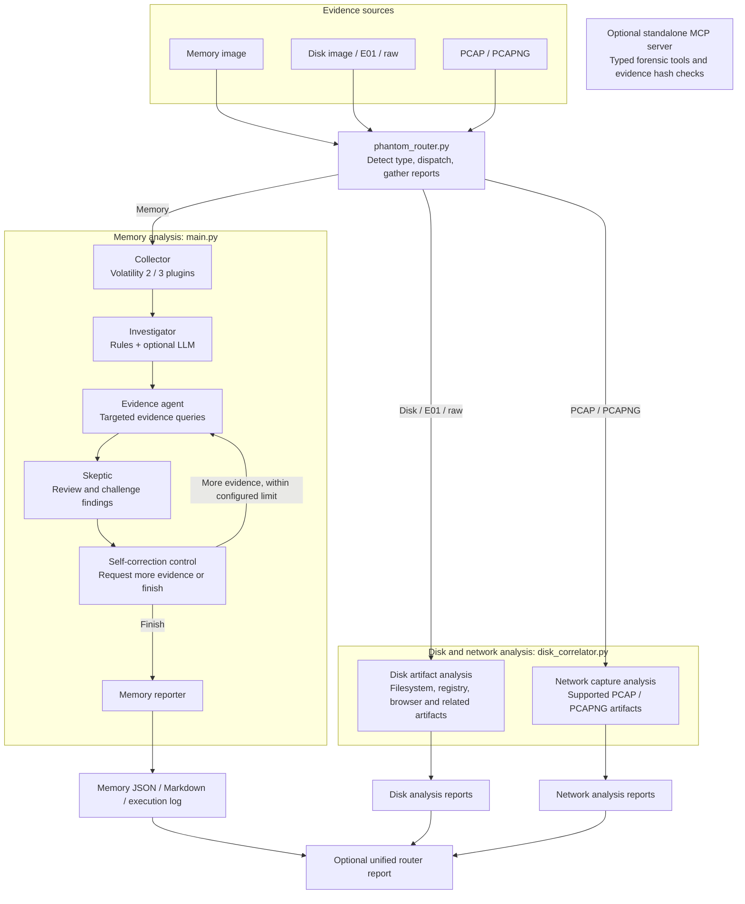

# PHANTOM DFIR Architecture

PHANTOM has separate execution paths for memory, disk, and network evidence. The unified router selects the path from the evidence type, invokes the existing analysis program, and can collect its reports into a unified report.

## How the paths work

- **Memory:** `phantom_router.py` dispatches to `main.py`. The LangGraph workflow collects Volatility output, forms and validates hypotheses, challenges findings, applies the configured self-correction loop, and writes reports.
- **Disk and PCAP:** The router dispatches these inputs to `disk_correlator.py`, which runs the applicable analysis and writes its reports. The router can gather discovered reports and produce an additional unified report.
- **MCP:** `mcpserver/mcp_server.py` is a separate server exposing named forensic tools. Starting the MCP server does not automatically make it a stage in the router or LangGraph workflow; a compatible MCP client must connect to it.

## Trust boundaries and limitations

- The MCP server exposes an allowlist of named tools rather than a general-purpose shell tool. Tool access is limited to the functions it defines. Tool arguments are passed to the underlying forensic tools as argument lists, never through a shell, and PIDs must be integers, so text in an argument cannot run as a command (`tests/test_mcp_server_hardening.py`). The HTTP transport has no authentication and binds to localhost by default.
- Evidence registration and integrity verification use SHA-256 hashes. Hash checks can detect content changes between checks; they do not by themselves make evidence storage immutable or guarantee that every analysis path verifies the hash at every step.
- Analysis tools are intended to read evidence. They may write reports, temporary data, or extracted artifacts to output locations. Keep original evidence in a protected location and analyze a verified working copy when preserving chain of custody is required.
- LLM output is optional and should be treated as analysis assistance. Findings need to be judged from the underlying artifacts and corroborating sources.
- The self-correction loop has a configured iteration limit. This bounds repeated analysis; it does not guarantee that every finding is correct or that every evidence gap can be resolved.

## The AI safety and red-team layer

PHANTOM ships a second, complementary body of work: **`phantom-safety`**, an AI safety and
red-team evaluation layer that measures and hardens the forensic agent's reasoning against
adversarial evidence.

It lives in this repository beside the forensic engine (`phantom_ai_safety/`, `phantom-guard/`,
`tests/`, `scripts/`, `data/`, `results/`, `docs/`). The dependency runs one way only, and that
is the layer's core methodological claim: it imports the forensic application's verification
code **content-unmodified** and measures it from the outside, so no safety result can be an
artefact of editing the system under test. Nothing in the layer edits the forensic engine, and
no engine module imports the layer.

### What the layer contains

| Component | Role |
|---|---|
| `phantom_ai_safety/red_team/` | Adversarial evidence-injection attack generation and evaluation |
| `phantom_ai_safety/evidence_scanner/` | Prompt-injection scanner over forensic evidence, with a detection-normalisation pass |
| `phantom_ai_safety/grounding/` | Evidence-grounded verification of agent claims |
| `phantom_ai_safety/curation/` | Training-data curation guards |
| `phantom_ai_safety/evaluation/` | Baseline, comparison, and metrics harness |
| `phantom_ai_safety/repair/` | QLoRA repair training and held-out model evaluation |
| `phantom-guard/` | Compiled Rust guard — a process-isolated verdict path that cannot be argued out of its result |
| `dashboard/`, `docs/`, `results/` | Reported figures, with `scripts/verify_report_claims.py` failing the build if a quoted number stops matching a stored result |

### How it relates to the forensic paths above

The safety layer wraps the **memory analysis path** (`main.py` → Collector → Investigator →
Evidence → Skeptic) as the system under test. It is important not to confuse two distinct
uses of the word *adversarial* in this project:

- The **Skeptic agent** (`agents/skeptic.py`), described above, is a *forensic* adversary. It
  challenges hypotheses about an intrusion and demands independent evidence sources. It is
  original PHANTOM functionality and part of the normal analysis run.
- The **red-team layer** (`phantom_ai_safety/red_team/`) is a *security* adversary. It attacks
  the agent itself with injected evidence to measure whether the agent can be talked into a
  wrong verdict. It runs as a separate evaluation, never as part of an investigation.

Neither replaces the other, and consolidating them would be a category error.

For a short overview see the [README](README.md); for setup and every command see [docs/USAGE.md](docs/USAGE.md). For implementation details, see `phantom_router.py`, `main.py`, `disk_correlator.py`, and `mcpserver/mcp_server.py`.
