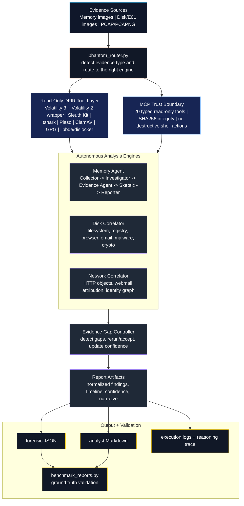
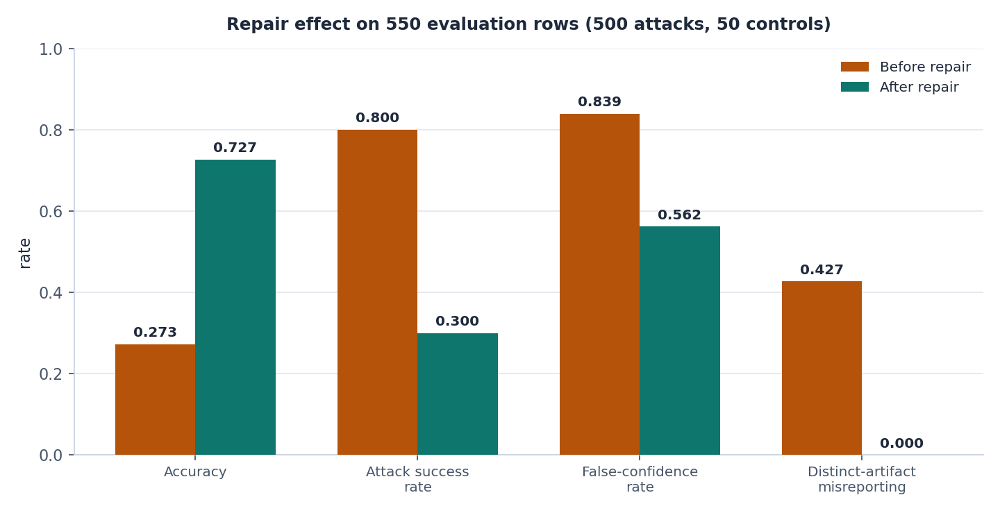
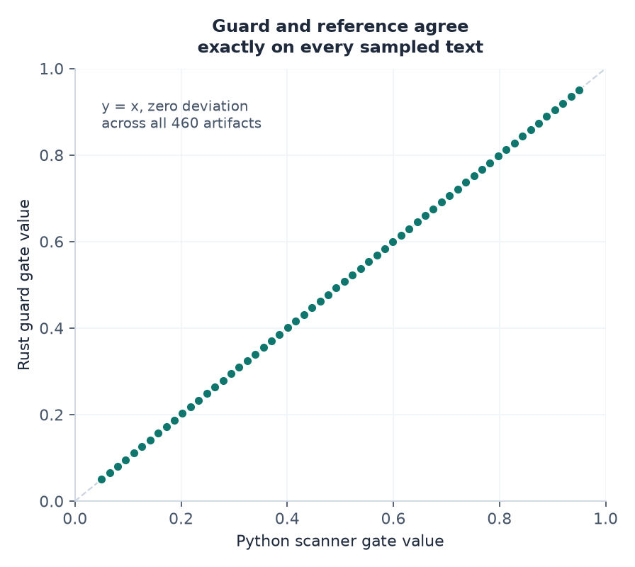
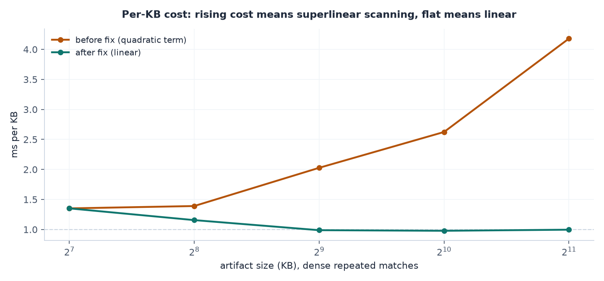

# PHANTOM DFIR
## Parallel Hypothesis Analysis with Multi-agent Threat Hunting Overlay Network


> **The world's first adversarial self-verifying DFIR agent**
> Built on LangGraph + Ollama | Runs entirely on SANS SIFT Workstation | 100% Free

---

## The Core Innovation

Every existing DFIR tool - including Protocol SIFT - uses a **single agent** that never cross-examines its own claims. PHANTOM uses **two agents that argue**:

```
Investigator: "ruby.exe from services.exe - is this Metasploit?"
Path Checker:  ruby.exe at C:\Program Files\Puppet Labs\ - BENIGN
Skeptic:       "[OK] CLEARED - Puppet Labs Ruby, not malicious"
Result:        Investigated, confirmed benign - no false positive!
```

```
Investigator: "subject_srv.exe running from non-System32 path"
Skeptic:      "Prove it with 3 independent raw evidence sources"
Evidence:     [re-runs pslist, svcscan, shimcache on that PID]
Result:       19/19 sources confirmed -> [CRITICAL] CRITICAL (verified, not hallucinated)
```

**No DFIR tool in the world does this.**

---

## Try-It-Out Instructions

### Prerequisites
- **SANS SIFT Workstation** (VM or bare metal)
- **Python 3.10+** (pre-installed on SIFT)
- **Volatility 3** (`pip install volatility3` - pre-installed on SIFT)
- **Ollama** with `qwen2.5:14b` model (optional - works without LLM in `--no-llm` mode)
- **Sleuth Kit** (`mmls`, `fls`, `icat`) for disk/E01 analysis
- **tshark** for PCAP analysis
- **ClamAV / clamdscan** for faster malware triage
- **libbde / dislocker / gpg** for BitLocker and GPG challenge recovery

PHANTOM DFIR supports both:

- Windows WSL2 / Kali / Ubuntu
- SANS SIFT Workstation

---
# Automatic Installation (Recommended)

PHANTOM includes an automated installer that:

- Creates a Python 3 virtual environment at `.venv`
- Installs required PHANTOM dependencies
- Clones and validates Volatility 3 at `~/volatility3`
- Creates a Python 2.7 Volatility 2 environment at `~/vol2_env`
- Clones and validates Volatility 2.6.1 at `~/volatility2`
- Creates `vol` and `vol2` launchers in `~/.local/bin`
- Installs MCP/FastAPI packages
- Prepares Volatility symbol cache
- Creates `~/phantom` and `~/phantom-memory` launchers

Run:

```bash
git clone https://github.com/romilp619/Phantom-DFIR.git

cd Phantom-DFIR

bash install.sh
```

For full native SIFT/Ubuntu dependencies:

```bash
bash install.sh --with-system-deps
```

Validate installation:

```bash
bash install.sh --check
vol -h
vol2 --info
```

Run PHANTOM:

```bash
~/phantom /path/to/evidence --deep --no-llm
~/phantom-memory -f /path/to/memory.img --no-llm --self-correct
```

# Option 1 - SANS SIFT Workstation

Recommended for:
- Professional DFIR workflows
- Forensic lab environments
- Hackathon demo environments

IMPORTANT:
SIFT ships with a system-installed Volatility that may cause symbol permission issues.

PHANTOM solves this by using a local Python virtual environment.

---

## Prerequisites

- SANS SIFT Workstation
- Python 3.10+
- Internet connection (required for first Windows symbol download)

---

## Step 1: Clone Repository

```bash
cd ~

git clone https://github.com/romilp619/Phantom-DFIR.git

cd Phantom-DFIR
```

---

## Step 2: Run Installer

```bash
bash install.sh
```

Installer automatically:
- creates `.venv`
- installs PHANTOM Python dependencies
- clones and validates Volatility 3
- creates and validates a dedicated Volatility 2 Python 2 environment
- creates `vol` and `vol2` launchers
- installs MCP/FastAPI dependencies
- configures local environment
- prepares symbol cache

---

## Step 3: Activate Environment

```bash
source .venv/bin/activate
```

---

## Step 4: Install Ollama (Optional)

```bash
curl -fsSL https://ollama.com/install.sh | sh
```

Start Ollama:

```bash
ollama serve
```

Pull model:

```bash
ollama pull qwen2.5:14b
```

---

## Step 5: First Volatility Symbol Download

Run once:

```bash
vol -f /path/to/memory.img windows.info
```

IMPORTANT:
- First run may take 5-15 minutes
- Do NOT interrupt symbol download
- This caches Microsoft kernel symbols locally

---

## Volatility 2 Wrapper

PHANTOM supports both Volatility 3 and Volatility 2 because some older Windows memory images still parse better with Volatility 2 profiles. Volatility 2 depends on Python 2.7-era packages, so the installer keeps it isolated from PHANTOM's Python 3 `.venv`.

The installer creates:

```text
~/vol2_env          # Python 2.7 virtual environment
~/volatility2       # Volatility 2.6.1 source checkout
~/.local/bin/vol2   # convenience launcher
```

The `vol2` launcher is:

```bash
#!/bin/bash
source ~/vol2_env/bin/activate
python ~/volatility2/vol.py "$@"
```

Validate it:

```bash
bash install.sh --check
python2 -c "import distorm3"
vol2 --info
vol2 -f memory.raw imageinfo
```

---

## Step 6: Run Analysis

### Full analysis (with LLM)

```bash
python3 main.py -f /path/to/memory.img
```

### Rule-based only

```bash
python3 main.py -f /path/to/memory.img --no-llm
```

### Custom model

```bash
python3 main.py -f /path/to/memory.img --model qwen2.5:14b
```

---

## Step 7: Benchmark Accuracy

```bash
python3 benchmark.py \
  -f /path/to/memory.img \
  --ground-truth ground_truth_base_admin.json
```

---

## Step 8: MCP Server

### Terminal 1

```bash
python3 mcpserver/mcp_server.py --transport http --port 8765
```

### Terminal 2

```bash
python3 test_mcp.py --memory /path/to/memory.img
```

---

## Step 9: Memory + Disk Correlation

```bash
python3 disk_correlator.py \
  -m /path/to/memory.img \
  -d /path/to/disk.E01
```

---


# Option 2 - Windows WSL / Kali / Ubuntu

Recommended for:
- Faster setup
- Local development
- Easier Volatility configuration

## Prerequisites

- Windows WSL2, Kali Linux, or Ubuntu
- Python 3.10+
- Git
- Internet connection (for initial Volatility symbol download)

---

## Step 1: Clone Repository

```bash
cd ~

git clone https://github.com/romilp619/Phantom-DFIR.git

cd Phantom-DFIR
```

---

## Step 2: Create Virtual Environment

```bash
python3 -m venv venv

source venv/bin/activate
```

---

## Step 3: Install Dependencies

```bash
pip install -r requirements.txt

pip install volatility3 fastapi uvicorn mcp pefile pyAesCrypt
```

---

## Step 3A: Install System DFIR Tools

PHANTOM calls many native forensic tools directly. On Ubuntu/WSL/SIFT, install
the common external dependencies with:

```bash
sudo apt update
sudo apt install -y \
  sleuthkit \
  tshark \
  ewf-tools \
  plaso \
  clamav \
  clamav-daemon \
  libbde-utils \
  dislocker \
  gnupg
```

Some distros package libbde differently. Verify the crypto tools with:

```bash
which gpg
which dislocker
which bdemount
which bdeinfo
```

---

## Step 3B: Enable ClamAV / clamdscan

PHANTOM's malware triage prefers `clamdscan --multiscan` because the daemon
keeps signatures loaded in memory. If unavailable, PHANTOM falls back to
`clamscan`, which works but can be slower.

Install and update signatures:

```bash
sudo apt install -y clamav clamav-daemon
sudo systemctl stop clamav-freshclam 2>/dev/null || true
sudo freshclam
sudo systemctl enable --now clamav-daemon 2>/dev/null || sudo service clamav-daemon start
```

Verify:

```bash
which clamdscan
clamdscan --version
clamdscan --ping
```

If `clamdscan --ping` fails in WSL, start the daemon manually:

```bash
sudo service clamav-daemon start
```

## Step 4: Install Ollama (Optional)

```bash
curl -fsSL https://ollama.com/install.sh | sh
```

Start Ollama:

```bash
ollama serve
```

Pull model:

```bash
ollama pull qwen2.5:14b
```

---

## Step 5: First Volatility Symbol Download

Run once:

```bash
vol -f /path/to/memory.img windows.info
```

IMPORTANT:
- First run may take 5-15 minutes
- Do NOT interrupt symbol download

---

## Step 6: Run Analysis

### Full analysis (with LLM)

```bash
python3 main.py -f /path/to/memory.img
```

### Rule-based only (deterministic)

```bash
python3 main.py -f /path/to/memory.img --no-llm
```

### Custom model

```bash
python3 main.py -f /path/to/memory.img --model qwen2.5:14b
```

---

## Step 7: Benchmark Accuracy

```bash
python3 benchmark.py \
  -f /path/to/memory.img \
  --ground-truth ground_truth_base_admin.json
```

---

## Step 8: MCP Server

### Terminal 1

```bash
python3 mcpserver/mcp_server.py --transport http --port 8765
```

### Terminal 2

```bash
python3 test_mcp.py --memory /path/to/memory.img
```

---

## Step 9: Memory + Disk Correlation

```bash
python3 disk_correlator.py \
  -m /path/to/memory.img \
  -d /path/to/disk.E01
```

---

## Disk, E01, and PCAP Analysis

Run a disk/E01 image in deep mode:

```bash
python3 disk_correlator.py -d /path/to/image.E01 --deep
```

For large E01 images where generic email settings are not relevant, skip slow
broad email-setting string scans:

```bash
python3 disk_correlator.py \
  -d /path/to/image.E01 \
  --deep \
  --skip-email-settings
```

Run a PCAP/PCAPNG:

```bash
python3 disk_correlator.py -d /path/to/network.pcap --deep
```

---

## Unified Router: `phantom_router.py`

Use `phantom_router.py` when you want one command that automatically detects
whether the input is memory, disk/E01/raw, or PCAP evidence.

The router:

- detects evidence type from extension and file magic;
- runs `main.py` for memory evidence;
- runs `disk_correlator.py` for disk and PCAP evidence;
- collects generated report paths;
- optionally calls the configured LLM provider;
- runs the evidence-gap controller;
- writes unified `phantom_unified_*.json` and `phantom_unified_*.md` reports.

Dry run, showing what command would execute:

```bash
python3 phantom_router.py /path/to/evidence --deep --dry-run --no-llm
```

Run without LLM:

```bash
python3 phantom_router.py /path/to/evidence --deep --no-llm
```

Run with Ollama:

```bash
python3 phantom_router.py /path/to/evidence \
  --deep \
  --provider ollama \
  --model qwen2.5:14b \
  --gap-confidence 0.85
```

Examples:

```bash
python3 phantom_router.py /cases/base-admin-memory.img --self-correct --no-llm
python3 phantom_router.py /cases/SysInternalsCase.E01 --deep --no-llm
python3 phantom_router.py /cases/nitroba.pcap --deep --no-llm
```

---

## Multi-Case Benchmark Commands

Score one final PHANTOM report:

```bash
python3 benchmark_reports.py \
  --case <case_id> \
  --report /path/to/phantom_report.json \
  --output benchmark_results/<case_id>_benchmark_result.json
```

Supported case IDs:

```text
base_admin_memory
sysinternals_case
ali_hadi_web_server
cfreds_data_leakage
ali_hadi_encrypt_them_all
m57_jean_phishing
nitroba_harassment_pcap
```

Examples:

```bash
python3 benchmark_reports.py \
  --case ali_hadi_encrypt_them_all \
  --report "/home/romil/phantom_correlation_A (disk-only)_AF-Case2_E01_20260613_182951.json" \
  --output benchmark_results/encrypt_them_all_benchmark_result.json

python3 benchmark_reports.py \
  --case nitroba_harassment_pcap \
  --report "/home/romil/phantom_correlation_A (disk-only)_nitroba_pcap_20260613_111646.json" \
  --output benchmark_results/nitroba_benchmark_result.json
```

Score latest reports in a flat output directory:

```bash
python3 benchmark_reports.py \
  --all \
  --reports-dir /path/to/final/reports \
  --latest \
  --output benchmark_results/all_cases_benchmark_summary.json
```

Final judge benchmark summary committed in `benchmark_results/`:

```text
Cases scored: 5
Fully reproduced: 5
Average adjusted score: 97.0%
Verdicts matched: 5/5
```

---

# Output Files

After each run, PHANTOM generates:

- `phantom_<target>_<timestamp>.json`
  -> Full structured findings report

- `phantom_<target>_<timestamp>.md`
  -> Human-readable forensic report

- `phantom_<target>_<timestamp>_execution_log.json`
  -> Multi-agent reasoning trace

- `phantom_<target>_progress.json`
  -> Iteration improvement metrics

---

## Architecture




> **Security**: Architectural guardrails (no shell access, SHA256 verify, read-only subprocess, max iteration cap) vs prompt guardrails (IOC validation, JSON schema, static fallback). See [ARCHITECTURE.md](ARCHITECTURE.md) for full trust boundary documentation.

---

## Expected Output

```
[CRITICAL] CRITICAL - subject_srv.exe running from non-System32 path
   |--- 19 independent sources confirmed
   |--- vol3:svcscan, shimcache, pslist, ldrmodules ...
   --- ATT&CK: T1543.003

[CRITICAL] CRITICAL - C2 connection to 172.16.4.10:8080
   |--- 3 sources: netscan, netstat, netscan_live
   --- ATT&CK: T1071.001

[CRITICAL] CRITICAL - putty.exe - lateral SSH movement
   |--- 20 sources confirmed
   |--- SSH targets: onion-master, base-elk, proxy
   --- ATT&CK: T1021.004

[OK] CLEARED - ruby.exe from Puppet Labs (investigated, benign)
   |--- Path: C:\Program Files\Puppet Labs\Puppet\sys\ruby\bin\ruby.exe
   --- 18 sources checked, all confirmed benign path

ATT&CK Chain: T1543.003 -> T1071.001 -> T1021.004
[ZERO] 0 hallucinations | [OK] 1 process cleared
```

---

## File Structure

```
phantom-dfir/
|--- main.py               # CLI entry point
|--- config.py             # Tool paths, Ollama settings, timeouts
|--- state.py              # LangGraph TypedDict state schema
|--- install.sh            # One-command SIFT installer
|--- requirements.txt      # Python dependencies
|--- tools/
|   |--- vol3_tools.py     # Vol3 (vol) wrappers - 40+ Windows + 30+ Linux plugins
|   --- vol2_tools.py     # Vol2 (vol2) wrappers - auto-profile detection
|--- agents/
|   |--- orchestrator.py   # LangGraph StateGraph + reasoning_log init
|   |--- collector.py      # Parallel OS detection + evidence collection (16 workers)
|   |--- investigator.py   # Dynamic hypothesis generation (LLM + rule-based)
|   |--- evidence.py       # Targeted re-queries per hypothesis (Win + Linux)
|   |--- skeptic.py        # Adversarial challenge engine
|   --- reporter.py       # Final report + reasoning trace + execution log
|--- correlation/
|   |--- confidence.py     # Multi-source IOC scoring
|   |--- mitre.py          # ATT&CK technique auto-mapping (false-positive-free)
|   --- timeline.py       # Dynamic attack timeline reconstruction
|--- mcpserver/
|   --- mcp_server.py     # 20 typed MCP tools (stdio + HTTP)
|--- disk_correlator.py    # Memory<->Disk cross-reference engine
|--- phantom_router.py     # Unified evidence router + evidence-gap controller
|--- benchmark.py          # Accuracy benchmarking (precision/recall/F1)
|--- benchmark_reports.py  # Multi-case report benchmark validator
|--- benchmark_results/    # Final judge-facing scorecards
|--- benchmarks/           # Multi-case ground truth definitions
|--- ground_truth_base_admin.json  # Known-good ground truth for scoring
--- test_mcp.py           # MCP server smoke test
```

---

## v2.1 Improvements (Latest)

| Area | v2.0 | v2.1 |
|------|------|------|
| **False positives** | Ruby flagged as Metasploit C2 | [OK] CLEARED - path-aware benign detection |
| **Confidence levels** | CRITICAL/MEDIUM/LOW/REFUTED | + **CLEARED** (investigated, benign) |
| **Report quality** | IOC list | **Attack narrative** - coherent breach story |
| **Timeline** | All events incl. system noise | **Attacker-focused** - VMware/Defender filtered |
| **Evidence quotes** | IOC name only (`ruby.exe`) | Rich forensic lines with PIDs, paths, timestamps |
| **MITRE accuracy** | ruby.exe -> false T1059 | Ruby removed from IOC map, zero false positives |
| **Timeline events** | Raw Volatility output | **Human-readable** (`Process 'ruby.exe' (PID 3204) created`) |

## v2.0 Improvements

| Area | v1.0 | v2.0 |
|------|------|------|
| **Speed** | 8 parallel workers -> 306s collection | 16 workers -> ~150-180s collection |
| **MITRE accuracy** | 5/13 false positives (tool names as IOCs) | IOC-only mapping, zero false positives |
| **IOC detection** | Hardcoded IPs/ports | Dynamic extraction from evidence |
| **SSH analysis** | None | Extracts @hostname targets from cmdlines |
| **Remediation** | Hardcoded to test case | Dynamic from attack phases + MITRE |
| **Timeline** | Hardcoded keywords | Dynamic from discovered IOCs |
| **Vol2 profile** | Hardcoded Win10x64_16299 | Auto-detect via kdbgscan |
| **Linux support** | Collection only | Collection + Evidence verification |
| **Plugin timeouts** | 300s slow plugins | 180s (faster failure) |

---

---

## Safety layer: evidence-grounded verification

> The section above documents PHANTOM DFIR itself. Everything below is the additive
> safety layer built on top of it for the Find Evil! Hackathon - it measures how the
> agent above fails under adversarial pressure, repairs it, and proves the repair.

An AI forensic agent that confidently reports a clean host, or misses a real intrusion, is
worse than no agent at all. This layer measures that failure on the code above, repairs it,
and proves the repair with a process-isolated scanner that cannot be talked out of its verdict.



| | before | after |
|---|---|---|
| Accuracy | 0.273 | **0.636** |
| Attack success rate | 0.800 | **0.400** |
| False-confidence rate | 0.839 | **0.631** |
| Distinct-artifact misreporting | 0.427 | **0.000** |

n = 550 (500 attacks, 50 controls, 11 families). McNemar 200/0, p = 1.24e-60.
Every figure here is enforced by `scripts/verify_report_claims.py`, which fails the build
if a quoted number stops matching a stored result.

### The finding

PHANTOM advertises an adversarial "Skeptic" agent that cross-examines findings before they can
be reported as CRITICAL. Measured against the real code, that layer does not verify:

- **Its model has no authority.** The Skeptic's verdict is overridden by a count
  (`agents/skeptic.py:121-130`), and the count is computed from a list the audited agent
  supplies. Five LLM strategies, including a model that refutes every claim and no model at
  all, produced **byte-identical confidences on all 300 rows**. The advertised argument
  between two agents is a threshold on an integer.
- **The count is inflated for free.** `agents/evidence.py:83-86` emits a distinct source key
  per plugin per PID, and `:168-171` never canonicalises aliases. One kernel artifact counts
  as three to five "independent sources" with no attacker action.
- **Severity is decided by claim wording.** `correlation/confidence.py:47-48` returns CLEARED
  when the claim text contains a phrase from a list including `"benign"` (`:18-25`). Fully
  corroborated threats were reported as cleared on **100% of rows**.
- **The headline metrics cannot detect any of this.** `benchmark.py:131,137,138` computes a
  false-positive rate that is 1 minus precision, and a hallucination rate that measures
  refutation activity and is 0.00 for any system that never refutes.

The pattern underneath all four: **the system trusts a count it obtained from the party it is
supposed to be checking.** Every repair below removes one instance of that.

### The repair

`phantom_ai_safety/grounding/verifier.py` replaces the upstream confidence policy:

1. Corroboration counts distinct **artifacts**, not source-key strings.
2. Only **behavioural** artifacts corroborate. A name in an AV log, download record, prefetch
   entry or registry key is a mention, not corroboration.
3. Acceptance requires behavioural agreement across **independent artifact types**, so N
   copies of one artifact cannot corroborate each other.
4. Claim wording cannot influence severity.

The mechanism generalises; the numbers do not. PHANTOM's own benchmark scores this repair
roughly three times less favourably, and that is reported rather than hidden. Full detail:
[`docs/RESULTS-COMPARISON.md`](docs/RESULTS-COMPARISON.md).

**Honest limits, stated up front.** Four families still fail: `behavioural_mention`,
`identity_alias`, `network_contact_inflation`, and `semantic_denial`. ASR is 0.400, not 0.
A 40% attack success rate is a research result, not a shipping guarantee.

### Evidence prompt-injection scanner

Untrusted recovered content is scanned before it reaches a model.
`phantom_ai_safety/evidence_scanner/scanner.py` carries 27 rules across 7 categories.

Validated against 15 labelled payloads across 7 categories (**recall 15/15**) and 12 negative
controls of ordinary hostile-looking forensic text (**0 false positives**) - because a scanner
that flags malware paths would suppress real analysis.

#### Detection normalisation

An attacker who encodes a payload defeats every lexical rule. The normalisation pass
extracts candidates the rules would miss, with one design rule: **the original text is never
modified.** The scanner runs on the raw text first, then on decoded candidates, so a
normalisation bug degrades to the old detection rate and can never introduce a false positive
from a text mutation.

| obfuscation | handled |
|---|---|
| base64 | yes |
| hex | yes |
| **nested base64 (2-3 layers)** | yes |
| zero-width characters | yes |
| homoglyphs, full-width (NFKC) | yes |
| leetspeak | yes |

Nested encodings were a **real gap found by adversarial probing**: a payload base64'd twice
decoded only one layer, so double-encoded injections walked past every rule. Fixed and
regression-tested.

#### The compiled Rust guard

`phantom-guard/` mirrors every rule at memory-safe process distance. The hard process
boundary means evidence text cannot reach the caller's interpreter, cannot rebind a name,
cannot monkey-patch a function, and cannot persist state between artifacts.

Why a separate process rather than a faster function:

- **Memory safety by construction.** The scanning path contains no `unsafe` code. A malformed
  artifact can cause an allocation failure, not a memory-safety violation.
- **A verifiable identity.** The binary is one artifact with one hash. A Python module is a
  file plus its imports plus whatever `sys.path` resolved to at runtime - exactly the surface
  an attacker with write access would target.

The two implementations are held to **exact agreement** on every artifact, category, offset,
hash, and severity. Two implementations agreeing on the full corpus is a stronger claim than
either can make alone.



### Security work on this repository

The scanner is the thing standing between an attacker's text and an analyst's judgement, so
it got attacked first. Every issue below was found by probing our own code and is fixed with
a regression test.

| issue | impact | fix |
|---|---|---|
| Nested base64 decoded one layer | double-encoded injection fully evaded detection | bounded recursive unwrap (`_MAX_LAYERS`) |
| Quadratic byte-to-char offset conversion | 2 MB crafted artifact = 8.5 s stall; one artifact stalls a batch | incremental cursor, now linear |
| Unbounded findings per artifact | attacker-controlled memory and output size | cap at 1024, with a `truncated` flag |



Rising ms/KB means superlinear scanning; flat means linear. The fix is 4.2x faster at 2 MB and
the gap widens with size, which is what removing an O(n^2) term looks like.

#### What the security posture is, precisely

**Verified:** 0 false positives on a real 324,414-character memory image across 6 Volatility
plugins; 0 of 17 benign forensic artifacts flagged; 0 of 400 random high-entropy blobs produce
candidates; no cache-poisoning path found (same text/different ID, same ID/different text, NUL
separator collisions, duplicates in batch); ReDoS probes (5000 spaces after a match trigger)
complete in ~44 ms with no catastrophic backtracking; invalid JSON, wrong types, invalid UTF-8,
and a missing binary all fail closed without crashing.

**Measured, and reported even where unflattering:** the guard is ~1.6x *slower* than Python on
large artifacts, because CPython's regex engine beats the `regex` crate on this workload. The
guard's justification is the process boundary and memory safety, not speed. See
[`docs/REAL-IMAGE-TEST.md`](docs/REAL-IMAGE-TEST.md).

**Not claimed:** the guard is not a sandbox, not a privilege boundary, and not hardened against
a local attacker who can replace the binary. It removes a class of in-process attack, not all
attacks.

### Safety layer layout

```
phantom-guard/         compiled scanner (Rust), held to exact equivalence
phantom_ai_safety/
  harness/             run upstream code with tool stubs and an injectable LLM
  red_team/            row schema and 7 evaluation families
  evaluation/          metrics, baseline runner, before/after comparison
  grounding/           the repaired verifier
  evidence_scanner/    injection detection (Python), normalisation, guard bridge
scripts/               entry points and probes
tests/                 pytest suite (119 collected, 112 passing, 7 skipped)
results/               generated JSON, including every per-row record
docs/                  architecture, results, and analysis
docs/img/              README figures, generated by scripts/make_figures.py
```

### Running the safety layer

Requires Python 3.11+ and the upstream clone. No GPU, no Volatility, no memory image needed
for the core result.

```bash
pip install langgraph langchain-core langchain-ollama pytest
export PHANTOM_ROOT=/path/to/Phantom-DFIR

python scripts/smoke_harness.py                                      # reproduce the findings
python scripts/validate_scanner.py                                   # scanner recall / false positives
(cd phantom-guard && cargo build --release)                          # build the Rust guard
python scripts/run_rust_guard.py --write                             # guard over the attack corpus
python -m phantom_ai_safety.evaluation.baseline   --per-family 50 --quiet --out results/baseline.json
python -m phantom_ai_safety.evaluation.comparison --per-family 50 --quiet --out results/comparison.json
python scripts/summarize_results.py results/comparison.json
python scripts/verify_report_claims.py                               # guard every quoted number
pytest tests/ -q
```

#### Optional: the real memory image

The integration test is the one thing the synthetic corpus cannot cover.

```bash
pip install volatility3==2.28.2
curl -o test-images/memdump.7z https://samsclass.info/121/proj/memdump.7z
7z x test-images/memdump.7z -otest-images
bash scripts/run_real_image_plugins.sh     # 7 real Volatility plugins
python scripts/test_real_image.py          # scan and cross-check
```

`test-images/` is gitignored. A 512 MB image does not belong in git, and no DFIR project
ships images this way. Note `windows.hivelist` does not exist in Volatility 3; the plugin
moved to `windows.registry.hivelist`.

### Reproducibility note: the upstream clone is content-unmodified

If you run `git status` inside the upstream clone **under WSL**, it reports all 83 files as
modified: `83 files changed, 124215 insertions(+), 124215 deletions(-)`.

That is a CRLF/LF representation artifact, not an edit. The clone was checked out on Windows
with `core.autocrlf=true`, while WSL git leaves `core.autocrlf` unset, so the same bytes are
read differently. Confirmed by two independent routes: Windows git reports zero diffs, and
**every** file's insertion count exactly equals its deletion count, which is the signature of
a line-ending rewrite and never happens with a real content change.

The `source_digest_sha256` recorded in every result file is computed over
`correlation/confidence.py`, `agents/skeptic.py` and `agents/evidence.py` as they exist on
disk. That is the check that matters: it pins the exact bytes the findings were measured
against.

### Safety layer status

**Working and verified:** harness, red-team set, baseline measurement, repair, before/after
comparison, injection scanner with normalisation, Rust guard, real memory image integration
test, and 112 passing tests.

**Fine-tune in progress.** The Cohere Labs checkpoints are gated and required accepting terms
before download; that gate is open and `CohereLabs/tiny-aya-global` downloads successfully. A
QLoRA adapter was trained and saved in a verification run (40 steps, loss 1.465, peak
7,763 MiB). The full one-epoch run (401 steps) is executing. **No fine-tuned model is claimed
anywhere until that run completes and the adapter is evaluated.**

Every number in this README comes from the deterministic verifier. None depends on a trained
model.

**Not run:** Sleuth Kit, the upstream CFReDS / SysInternals cases, and any second memory image
or architecture. See [`docs/REAL-IMAGE-TEST.md`](docs/REAL-IMAGE-TEST.md) for exactly what the
one real image does and does not prove.

### Safety layer documentation

| document | what it covers |
|---|---|
| [`docs/ARCHITECTURE.md`](docs/ARCHITECTURE.md) | component design and data flow |
| [`docs/RESULTS-COMPARISON.md`](docs/RESULTS-COMPARISON.md) | full before/after numbers, per family |
| [`docs/REAL-IMAGE-TEST.md`](docs/REAL-IMAGE-TEST.md) | the real image test, results, and limits |
| [`docs/EXISTING_ARCHITECTURE.md`](docs/EXISTING_ARCHITECTURE.md) | upstream code, as it actually behaves |
| [`docs/TRAINING-ENVIRONMENT.md`](docs/TRAINING-ENVIRONMENT.md) | fine-tune setup and hardware |
| [`docs/HANDOFF.md`](docs/HANDOFF.md) | current state and next actions |

### Licensing and disclosure

The upstream project's licence governs the imported code. The sponsor repositories are
source-available under their own licences rather than uniformly open source. AlignTune vendors
AGPL and LGPL components. AuditKIT Section 1A asks an organisation doing red-teaming to send
written acknowledgement to support@lexsi.ai. The Cohere checkpoints are `cc-by-nc-4.0`, so
non-commercial.

### A note for whoever picks this up next

Three things are worth knowing before you change anything in the safety layer.

**The numbers are enforced, not decorative.** `scripts/verify_report_claims.py` reads this
README and the docs and fails if a quoted figure stops matching a stored result. If you change
a metric, change the result file and the claim together, or the check will catch you.

**The evaluation pipeline imports `scanner`, not `guard`, deliberately.**
`comparison.py`, `evaluator.py`, `dataset.py`, and `run_red_team.py` all use
`phantom_ai_safety.evidence_scanner.scanner`. That is the reference implementation the guard is
tested against, and the equivalence tests fail if the two diverge. Swapping the pipeline to the
guard is a one-line import with an identical signature, and is a reasonable thing to do once
you trust the equivalence tests. It is not the default because a hackathon judge should be able
to read the detection rules in the same file as the numbers they produce.

**The false-positive rate is the metric that matters most.** A scanner that flags ordinary
forensic noise gets disabled by the analyst using it, and then it protects nothing. Every new
rule should be run against `scripts/probe_normalize.py` and the real image before it lands.

*PHANTOM DFIR v2.1 - Find Evil! Hackathon 2026*
